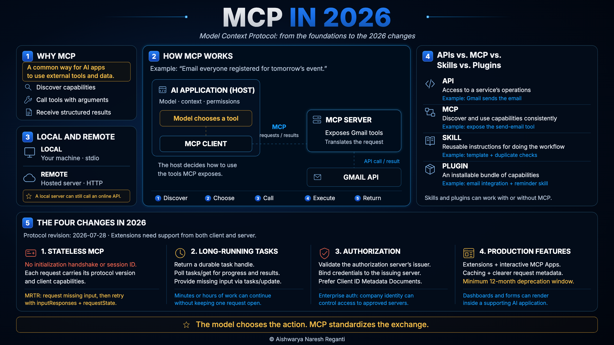

# How MCP Works in 2026 Explained For Beginners

**Video: Coming up soon.**
<!-- Replace this placeholder with the public YouTube URL once the video is live. -->

## In this video

- **What MCP is and why it exists**: a common way for AI applications to discover and use external tools and data
- **How it works under the hood**: hosts, clients, servers, and an email request followed from the model to the underlying API and back
- **Local and remote servers**: where the integration runs and how the client connects to it
- **APIs, MCP, skills and plugins**: what each one does and how they fit together
- **The four changes in 2026**: stateless requests, long-running Tasks, stronger authorization, and capabilities for production use

## Visual cheat sheet

[Open the full-resolution graphic](images/mcp-in-2026.png) · [Read the companion cheat sheet](mcp-cheatsheet.md)

## Resources

- [MCP documentation](https://modelcontextprotocol.io/docs/2026-07-28/learn/architecture), for the host, client and server architecture
- [July 2026 specification changelog](https://modelcontextprotocol.io/specification/2026-07-28/changelog), for the protocol changes covered in the video
- [Multi Round-Trip Requests](https://modelcontextprotocol.io/specification/2026-07-28/basic/patterns/mrtr), for requests that need more input before they can finish
- [MCP Tasks](https://modelcontextprotocol.io/extensions/tasks/overview), for long-running operations and durable task handles
- [Authorization specification](https://modelcontextprotocol.io/specification/2026-07-28/basic/authorization), for identity, credentials and access
- [MCP Apps](https://blog.modelcontextprotocol.io/posts/2026-01-26-mcp-apps/), for interactive interfaces inside supporting hosts
- [Enterprise-Managed Authorization](https://blog.modelcontextprotocol.io/posts/enterprise-managed-auth/), for access through a company's identity provider
- [Agent Skills](https://agentskills.io/home), for reusable instructions, resources and scripts

## Sources and clarifications

- **Launch:** [Anthropic's MCP announcement](https://www.anthropic.com/news/model-context-protocol), November 25, 2024.
- **Usage growth:** [Agentic AI Foundation, September 1, 2026](https://aaif.io/blog/mcp-usage-surged-as-the-protocol-went-stateless). ChatGPT users' MCP tool calls grew 98 times from January to August 2026. Railway reported daily MCP user growth of more than 500% from July to August. These are separate measures, not a single growth rate for the whole ecosystem.
- **2026 protocol changes:** the [2026-07-28 changelog](https://modelcontextprotocol.io/specification/2026-07-28/changelog) documents the stateless design, MRTR, Tasks moving into an extension, authorization changes, caching, request headers and deprecation policy. Earlier clients and servers may still use earlier protocol revisions.
- **Tasks:** the [Tasks extension](https://modelcontextprotocol.io/extensions/tasks/overview) uses `tasks/get` for status and results and `tasks/update` for additional input. Client and server must support it. Cancellation is cooperative, not a guarantee that work stops immediately.
- **Security:** [NSA, Model Context Protocol: Security Design Considerations for AI-Driven Automation](https://media.defense.gov/2026/Jun/02/2003943289/-1/-1/0/CSI_MCP_SECURITY.PDF), May 20, 2026. Authorization improvements do not eliminate prompt injection, tool poisoning or inappropriate tool use.
- **Examples:** the Gmail integration and event-reminder workflow illustrate the architecture. MCP servers can be built by providers, third parties or your own team. Skills and plugins can work with or without MCP.

## Video script

_Reading version adapted from the recording script, with production directions removed and technical clarifications added. This is not the final edited transcript. It will be replaced with the published video's captions when available._

MCP is blowing up yet again in 2026. MCP calls from ChatGPT users have apparently
multiplied 98 times from just January to August, and companies are reporting more than 500%
growth in usage of their MCP servers in just the past few months.

I think a big reason for this interest is all the recent updates. MCP looks very different
now, even compared with just a few months ago.

If you're a beginner, confused by all these updates and wondering where to start, this is
the only video you need. We'll go all the way from the foundations to the current state of
MCP in 2026. So by the end of this, all of that confusion should be gone, and you'll be able
to explain MCP clearly to anybody, including everything that's changed this year.

Here's everything we're going to cover:

- What MCP is and why it exists.
- How MCP actually works under the hood.
- How MCP is different from APIs, skills and plugins, and how they all fit together.
- The four big things that changed in 2026, and why each one happened.

If you're new here, I'm Aishwarya Reganti. I've been working in AI for more than a decade, I
have patents and publications in some of the top AI conferences, and until last year I was
an AI scientist and tech lead at AWS building production systems for large enterprises. Now
I run my own startup, LevelUp Labs, where we help companies go AI native.

---

### What MCP is and why it exists

MCP, or Model Context Protocol, is an open standard that gives AI applications a consistent
way to connect to external tools and data. It was introduced by Anthropic in late 2024, and
honestly, for a good part of the first few months, it really wasn't that popular.

What really started the momentum was the agentic AI wave. Remember that the whole promise of
agents is that you're no longer just chatting with a model and having a conversation. You
want it to actually go and do work for you. And a lot of our actual work lives inside
external applications, right? Our emails, our calendars, CRMs, databases, GitHub, and so on.
So if an agent's going to do anything meaningful for you, it's going to need some way to
connect to all of these applications. And as agents became more popular, MCP started getting a lot more
attention too, and that accelerated even further as major companies like OpenAI and Google
started supporting it.

But this raises a pretty obvious question, right? App integrations have been around for a long time
through APIs. Gmail has an API. Stripe has an API. GitHub has an API. So why did we suddenly
need MCP?

Now, APIs were primarily designed for developers writing software. So let's say I'm an
engineer building an application that sends automatic emails to my subscribers whenever I have an
event coming up, and I want to use Gmail to send those emails. I can go and read Gmail's API
documentation, understand the operations it exposes, understand what information each
request needs, and write deterministic software that creates the right request.

Now let's say I want my agent to do that work instead. I tell it, send an email to everyone
who registered for tomorrow's event. So the model now has to replace some of the work the
engineer was previously doing. It needs to know what it can actually do with Gmail, what
operations are available, what they mean, what arguments they expect, and what kind of
request it needs to construct.

So the API already gives us the ability to connect to Gmail, but there's still a lot of
context the model needs before it can use that API reliably. And that's why developers
started building a middle layer themselves. You'd expose a set of tools to the model and
essentially say, these are the things you can do with Gmail. Send email is one of them. This
is what it does, and these are the arguments you need to provide, so say the sender email, the receiver name, and the
receiver email.

Now the model has the context it needs. It can look at the user's request, identify the
right tool, construct a structured request with the right arguments, and the software
underneath can translate that into the actual Gmail API call. And the response from Gmail
comes back through that same layer to the model.

The problem was that there wasn't a standard way to build this middle layer. Different AI
applications and frameworks could describe tools differently, discover them differently,
invoke them differently, and return results differently. So everybody was essentially
building their own version of the bridge between the model and the API.

And that's the problem MCP is trying to solve. It standardises this layer, so that AI
applications have a common way to discover external capabilities, understand how to use
them, call them, and receive results.

There was also another layer of overhead around security and authorization. The underlying
APIs might already support OAuth, API keys, and other authentication mechanisms, but the AI
integration still needs to connect those credentials and permissions into the agent
experience safely. And MCP has increasingly standardised parts of that connection as well,
so that every integration doesn't have to go and invent the whole authorization flow
independently.

---

### How MCP works under the hood

So now let's understand a little bit about how MCP actually works under the hood. MCP uses a
client and server architecture. That might sound technical, but it's actually pretty
easy to understand, so stick with me.

There are three terms you need to know. The first is the **host**. This is the larger AI
application you're actually using, so something like Codex, Claude Code, or Cursor. And
remember that these applications do a lot more than MCP. They manage the model, the context,
permissions, tool use, and the rest of the agent experience.

Inside that host is an **MCP client**. This is essentially the part of that larger
application that handles MCP. It knows how to communicate with MCP servers, understand what
they expose, send requests, and receive responses.

And then there's the **MCP server**, which can come from the application provider, a third party, or your own team. It's the thing that exposes
the capabilities of an external application using MCP conventions, and the code inside that
server knows how to translate those MCP requests into whatever the underlying application
actually expects.

Now, one thing you want to remember here is that for the same application, there can be two
different kinds of MCP server.

The first one is local, which means the server is running on your own machine. The host
launches it as a program, and the two of them talk over something called stdio. That's
standard input and output, so it's pretty much the way any program on your computer takes
something in and writes something back out.

The second one is remote, which means that server runs on infrastructure managed by a provider or another operator, and the host connects to it over HTTP.

But remember that in both of those cases, the server is still going out and calling Gmail's
API over the internet. So what's changing is where that middle layer runs, and who's holding
your credentials.

To make that easier to visualise, let's stick with our email example. You open Codex and
say, send an email to everyone who registered for tomorrow's event. Codex is the host. And
inside Codex, its MCP client is connected to the Gmail MCP server.

The Gmail MCP server exposes what tools are available, what each one does, and what
arguments they require. Codex can then make that information available to the AI model
inside it. The model looks at your request, figures out which tool it needs, and generates
the required arguments. And Codex uses its MCP client to send that request to the Gmail MCP
server.

The Gmail MCP server takes that standardised MCP request and translates it into whatever
Gmail's actual API expects. Gmail performs the action, sends the response back, and that
result comes back through the MCP server and the client to Codex.

So what MCP gives us is that standardised layer on top of all these different APIs. The
applications underneath can all work completely differently, but the AI application has one
common way to discover capabilities, invoke them, and receive the results.

Now remember another thing here, because we'll bring this back when we talk about what
changed in 2026. The original MCP lifecycle had four basic ideas.
**Initialization, discovery, request and response, and session.**

First **initialization**. The MCP client and server would essentially introduce
themselves, agree on which version of MCP they were speaking, and exchange information about
what each side supported.

Then  **discovery**. The client could ask the server what it actually exposed. So in our
Gmail example, the server might return tools for searching email, reading email, and sending
email, along with what each one does and what arguments it expects.

Then you have the actual **request and response**. The model decides which capability it
needs, the client sends that structured request over to the MCP server, and the server does
the work and hands back a structured result.

And finally, the server could create a **session** during initialization. And you can think of
the session ID as the server's way of knowing where a request is coming from and which
ongoing interaction it belongs to. The client would include that session ID with future
requests, so the server could associate them with the same session.

So keep those four things in mind. Initialization, discovery, request and response, and
session.

---

### MCP versus APIs, skills and plugins

Now, before we get to what changed, there are a few other terms that get mixed up with MCP
constantly. APIs, skills, and plugins. And now that you've seen how MCP actually works
underneath, let's understand how the others are different. In fact, you can think of these as
layers of the same system. You can almost visualise it as the API at the bottom, MCP on top
of it, the skill above that, and the plugin as the box around it. So let's see why.

So let's start with APIs, because it should now be obvious why they're still required. If an
AI system needs to interact with an external application, the bottom layer is still the API.

MCP doesn't replace that API. It sits on top of it, and gives the AI system a standardised
way to discover and use those application capabilities. The MCP server can translate between
the standardised MCP request on one side and whatever the application's API expects on the
other.

And then at the top, you can think of **skills** as the workflow layer. A skill contains
reusable knowledge about how a particular task should be done. It can include instructions,
procedures, examples, scripts, or any other context that helps an agent follow a repeatable
workflow.

So take our event reminder example. You could build an event reminder skill that teaches the
agent how your company writes reminder emails. Maybe every reminder needs the event name,
the location, the joining link, what attendees should prepare, and a particular brand voice.

That skill teaches the agent how the task should be done. And when the agent actually needs
to send the email, it can use the sending capability exposed through the Gmail MCP server.
And underneath that, the Gmail MCP server talks to Gmail's API.

And then there are plugins, which you'll run into in AI applications. A plugin is a packaging unit. It can bundle skills, app integrations, MCP servers, or other capabilities into a single installable thing. The contents depend on the application.

An email plugin could package the integration and the reminder workflow together, so you install one thing instead of wiring it together yourself. It may use MCP underneath, but plugins and skills do not have to use MCP.

So the simple mental model is this. The API is how software interacts with the external
application. MCP is the standardised connection layer that lets the AI system discover and
use those capabilities. The skill is the workflow layer that teaches the agent how the job
should be done. And a plugin is the bundle that ships you multiple skills and workflows, which might also
use MCP
together.

Y
So that's the foundation, and
that's how the pieces fit together. Now let's get into what's actually changed this year.

---

### What changed in MCP in 2026

So now we've got the foundations of MCP down. But a lot has changed in 2026 alone, to the
point where MCP today works quite differently from the version people were using only a few
months ago. There are four major changes that I think every builder should know about, and
let's go through each one and, more importantly, why it happened.

The first major change is that **MCP became stateless**. So what does that actually mean?

Go back to the four pieces we just learned. Initialization, discovery, request and response,
and session. The client and server would initialize their connection, and the server could
create a session. Future requests carried that session ID, so the server knew they belonged
to the same ongoing interaction.

Now take the Gmail MCP server from our example. At a very large scale, you're not going to
have one server handling every single request. You'll have multiple server copies and 
instances handling the load.

So say the first request from user one reaches server one. That server knows the state
associated with that session. But the next request from the same user happens to reach
server seven. And server seven doesn't have whatever state server one was maintaining.

There are basically two ways around this. You keep routing that client back to the same
server, or you make sure all the server instances have access to shared session state. And
both of those add infrastructure complexity, because the protocol itself expects the server
to remember this ongoing interaction.

So one of the biggest changes in the July 2026 specification was removing that requirement.
The initialization handshake went away, and the MCP session ID went away. Every request is
now self contained at the protocol level. So instead of introducing itself once and
expecting the server to remember that information later, the client includes the information
the server needs with each request.

And that makes MCP much easier to scale.

But removing sessions creates another pretty interesting problem. What if the server starts
processing your request and realises that it needs something else from you before it can
finish?

Say you ask it to email everyone registered for an event. Before sending hundreds of emails,
the server wants you to confirm the action. So if we no longer have this ongoing session,
how does it stop and ask for that input?

And this is where **Multi Round Trip Requests** come in. Now, the important thing here is
that this isn't a callback, where the server somehow reaches back out to you later. The
first request actually finishes and closes.

What the server sends back is a special type of response. So instead of the normal result,
it comes back flagged as input required, and that flag is the signal to the client that the
work isn't finished and that something is needed from you. Along with that flag, the server
sends back a small piece of request state, which is essentially its own note to itself about
where it had got to.

So that's the first big shift. MCP moved away from keeping an ongoing protocol session, and
towards independent requests, while still giving us a way to handle interactions that need
more than one round.

The second major change is **MCP Tasks**, and this one comes from how much agents themselves
have changed.

When MCP was first designed, a lot of agent interactions looked much closer to normal tool
calls. Search something. Read something. Send something. The request happens, and you've got
the result back fairly quickly.

But agents can now take on much longer pieces of work. You might ask one to analyse a large
codebase, process thousands of customer conversations, run a deep research workflow, or do
something that takes several minutes or even hours.

And you really don't want one MCP request sitting open the entire time, waiting for that
work to finish.

So this is where the idea of an **MCP Task** comes in. The server can decide that a particular request should become a Task instead of
returning the final result immediately. It hands back a task handle, and the client can use
that handle to check the status, update the task, cancel it, and eventually go and get the
result. Tasks were redesigned around the new stateless architecture, and they now live in
the MCP extension system.

So now MCP has a much cleaner model for work that doesn't finish in one quick request. The
request can kick the work off, but the work itself carries on independently.

The third major change is that **security and authorization got much stronger**.

As MCP adoption grew, people started connecting agents to email, source code, CRMs, internal
databases, and a lot of other systems containing sensitive information. So identity,
credentials and permissions started mattering a lot more.

The July specification tightened the authorization model itself. So for instance, clients now
have stronger rules for verifying which authorization server actually issued a credential,
and credentials are more carefully tied to the issuer that created them. MCP also moved away
from having clients dynamically register themselves with every authorization server, and
towards client metadata documents, which give authorization systems a more predictable way
to identify clients.

And then **Enterprise Managed Authorization** became stable. And what that means is that if a
company's got thousands of employees and a set of approved MCP servers, it can centrally
provision access through its existing identity provider. So users get access to the servers
they're allowed to use through their company login, instead of individually authorizing
every server themselves.

And all of this was happening at a time when security concerns around MCP were becoming much
harder to ignore. Researchers had already demonstrated things like tool poisoning and data
exfiltration, and in May 2026 the NSA published specific security guidance for systems using
MCP. Now, these authorization improvements don't solve every one of those security problems,
but they do strengthen one very important part of the system, which is deciding who is
connecting, what credentials they're using, and what they're allowed to access.

The fourth shift is that **MCP became much more production ready**, and this one is really a
collection of changes rather than a single feature.

**Extensions.** MCP now has a formal extension system. So instead of putting every new
capability directly into the core protocol, optional capabilities can evolve separately. MCP
Tasks, MCP Apps, and Enterprise Managed Authorization can all live as extensions, so every
server and client doesn't have to support every possible feature.

**MCP Apps.** MCP can now support richer interfaces, instead of always returning only text or
data. A server can hand back an interactive interface that a supporting host can render. So an
analytics tool could return a dashboard, a workflow could return a form, or a CRM tool could
return an interactive customer view.

**Caching and easier request handling.** Tool lists and other list responses can now include
caching information, so clients don't have to keep fetching the same catalogue again and
again. Requests also expose information like the method and the tool name more clearly, which
makes it easier for the systems handling MCP traffic to understand what kind of request is
coming in.

**More predictable protocol changes.** MCP now has a formal deprecation policy, with a
minimum twelve month window before deprecated functionality is removed. And that's giving companies
building on MCP a lot more time to plan migrations, instead of suddenly reacting to breaking
changes.

So if you step back and look at this from 10,000 feet, the pattern across all four changes
is pretty clear. MCP originally solved
the problem of giving AI applications a common way to connect to external tools and data. And
in 2026, the focus shifted towards what happens once those connections are being used at much
larger scale, by agents doing much longer pieces of work, with much more sensitive access,
inside systems that companies actually need to depend on.

Hopefully that gives you a clear idea of what MCP is, how it's changed in 2026, and why it
matters to you if you're building with MCP.

I'll see you in the next video. Do subscribe if you'd like to see more deep-dive videos.

All the very best.
